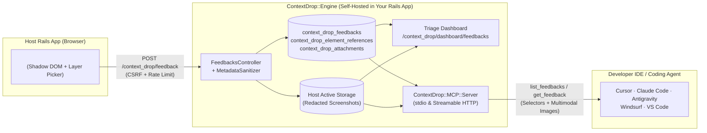

<p align="center">
  
</p>

<p align="center">
  <strong>Stop decoding vague bug reports! Let users pin the problem with your Rails app</strong><br />
  Mountable Rails Engine · Shadow DOM Widget · Overlapping Layer Picker · Active Storage · MCP Server
</p>

<p align="center">
  <a href="https://rubygems.org/gems/context_drop"></a>
  <a href="https://rubygems.org/gems/context_drop"></a>
  = 3.1" />
  = 7.1" />
  <a href="MIT-LICENSE"></a>
</p>

<p align="center">
  <a href="https://rubygems.org/gems/context_drop">RubyGems</a> ·
  <a href="#quickstart">Quickstart</a> ·
  <a href="#interactive-playground">Live Demo</a> ·
  <a href="#dom-pinning--layer-disambiguation">Layer Picker</a> ·
  <a href="#mcp">MCP Server</a> ·
  <a href="#zero-trust-privacy--redaction">Privacy &amp; Redaction</a> ·
  <a href="#configuration">Configuration</a>
</p>

---

## Why

 When someone reports *"the button on the checkout card isn't working,"* engineers usually spend 20 minutes hunting down which view partial, feature flag, viewport width, or overlapping toast banner caused the problem.

**ContextDrop** (`context_drop`) embeds a tactile, zero-bleed **Shadow DOM feedback composer and DOM pin selector** directly into your Ruby on Rails application (`Rails >= 7.1`, including `Rails 8+`). Reporters click **Pin Element**, point at any UI component (even underneath floating badges or cascading overlays) attach a privacy-redacted screenshot, and send.

<p align="center">
  
</p>

> **Above:** Active **Pin Mode** on the live demo page. While hovering over a stacked UI card (`section #scenario-overlapping-layers · 681×350 · 1/6 layers`), ContextDrop frames the target in Inspector Cobalt, displays layer depth for mouse-wheel cycling, and collapses the chatbox into the **Compact Pinning Bar** (`Pinning`, live DOM ancestor breadcrumbs, Up/Down layer controls, and `Chat` toggle) so the host page stays completely unobstructed.

<table>
  <thead>
    <tr>
      <th width="50%" align="left">1. Open the Floating Composer or Pin Dock</th>
      <th width="50%" align="left">2. Pin DOM Layers &amp; Capture Element Screenshots</th>
    </tr>
  </thead>
  <tbody>
    <tr>
      <td valign="top">
        
        <p>
          Drop <code>&lt;%= context_drop_widget %&gt;</code> into your layout to render a draggable, Shadow DOM-isolated feedback composer. Click the top-left <strong>Pin Element</strong> button (or the freely floating pin dock) to start selecting elements on the page.
        </p>
      </td>
      <td valign="top">
        
        <p>
          Every pinned element is added to the context tray (`#scenario-overlapping-layers`) with a live count badge (`Pin Element 1`). Hover the chip to highlight the element on the page, click the camera icon to crop a screenshot of that exact node, and hit <strong>Send</strong>.
        </p>
      </td>
    </tr>
  </tbody>
</table>

---

## Why ContextDrop

| Capability | Typical SaaS Feedback Widgets | Manual Slack / Issue Reports | **ContextDrop (`context_drop`)** |
|---|---|---|---|
| **Data & Storage Ownership** | Exfiltrates DOM & screenshots to 3rd-party cloud servers | Scattered across chat threads | **100% self-hosted** in your Rails DB (`context_drop_*`) & **Active Storage** |
| **Overlapping DOM Layers** | Gets stuck on topmost wrapper, modal backdrop, or toast | Requires reporter to open DevTools | **Scroll-wheel depth cycling**, **Click-to-Pick Layer Popover**, & **DOM Breadcrumbs** |
| **Host Page Safety** | Injects global CSS; clicks can accidentally fire host buttons | N/A | **Strict Shadow DOM isolation** + capture-phase event suppression during Pin Mode |
| **Sensitive Data Protection** | Captures raw DOM or requires complex PII scrubbing rules | Risk of unredacted screenshots | **Zero-trust redaction** before rasterization (`[data-feedback-sensitive]`, passwords, cards) |
| **Authentication Model** | Separate vendor accounts & seats | Manual identity lookup | **Host-agnostic polymorphic `submitter`** (Devise, Rails 8 Auth, Sorcery, custom, or anonymous) |
| **Developer Resolution Flow** | Copy-paste from external vendor dashboard | Back-and-forth reproduction questions | **Built-in Rails Triage Dashboard** + **Native MCP Server** (`stdio` & HTTP) for Cursor / Claude Code / Antigravity |

> [!IMPORTANT]
> **Core Architectural Principle: ContextDrop owns its domain. Your Rails app owns its identity and infrastructure.**  
> ContextDrop mounts cleanly as an isolated Rails Engine (`isolate_namespace ContextDrop`) with zero mandatory frontend framework dependencies (no React, Vue, or Tailwind required).

---

## Quickstart

### Requirements

- **Ruby** `>= 3.1`
- **Ruby on Rails** `>= 7.1` (`7.1`, `7.2`, `8.0+`)
- **Active Storage** installed in the host application (`bin/rails active_storage:install`)

### 1. Install the Gem & Run the Generator

Install [`context_drop` from RubyGems.org](https://rubygems.org/gems/context_drop) (or add `gem "context_drop"` to your `Gemfile`):

```bash
bundle add context_drop
bin/rails generate context_drop:install
bin/rails db:migrate
```

What `bin/rails generate context_drop:install` sets up for you:
1. Creates [`config/initializers/context_drop.rb`](lib/generators/context_drop/install/templates/initializer.rb.tt).
2. Mounts `mount ContextDrop::Engine => "/context_drop"` in `config/routes.rb`.
3. Copies three engine-owned migrations (`context_drop_feedbacks`, `context_drop_element_references`, `context_drop_attachments`) into `db/migrate/`.
4. Verifies that Active Storage migrations are present.

### 2. Render the Widget in Your Layout

Add `<%= context_drop_widget %>` right before `</body>` in `app/views/layouts/application.html.erb`:

```erb
<%= context_drop_widget %>
```

Need page-specific copy or release metadata? Override options per view without mutating global configuration:

```erb
<%= context_drop_widget(
  position: :bottom_left,
  placeholder: "Spot an issue with checkout? Pin the element and let us know...",
  metadata: { release: ENV["GIT_COMMIT_SHA"], feature_flag: "checkout_v2" }
) %>
```

### 3. Enable & Launch

```bash
export CONTEXT_DROP_ENABLED=true
bin/rails server
```

Visit any page in your Rails app to use the floating widget, or open `/context_drop/dashboard/feedbacks` to triage submissions.

---

## Interactive Playground

Want to test the floating Pin selector, overlapping-layer disambiguation, draggable chatbox, and live payload inspector before installing the gem into a Rails app? Run the standalone playground in this repository:

```bash
# Start the local interactive demo server at http://127.0.0.1:4173
npm run demo

# Or open demo/index.html directly in your browser (works offline via built-in payload interceptor)
open demo/index.html
```

---

## Feedback-to-Fix Loop



Every submission captures a rich, sanitized engineering payload:
- **`ContextDrop::Feedback` (`context_drop_feedbacks`):** Polymorphic `submitter` (`User`, `Employee`, `AdminUser`, or anonymous), `message`, `page_url`, `user_agent`, `viewport` & custom `metadata`, and workflow `status` (`new`, `reviewed`, `resolved`, `dismissed`).
- **`ContextDrop::ElementReference` (`context_drop_element_references`):** Point-in-time DOM snapshot including `tag_name`, best-effort CSS `selector`, structural `dom_path`, truncated `text_content`, allowlisted `attributes_snapshot` (`id`, `class`, `role`, `aria-*`, `data-testid`), and CSS pixel `bounding_rect` (`{ x, y, width, height }`).
- **`ContextDrop::Attachment` (`context_drop_attachments`):** Viewport screenshots, element-cropped screenshots (linked via `element_reference_id`), and uploaded images stored in your app's **Active Storage**.

---

## DOM Pinning & Layer Disambiguation

Real-world Rails interfaces have sticky navbars, floating promo ribbons, translucent toast notifications, and deeply nested Flexbox/Grid containers. ContextDrop makes selecting the exact underlying element effortless:

1. **Top-Left Pin Selector & Freely Draggable Dock:** Click **Pin Element** in the top-left corner of the chatbox (or from the floating dock). The chatbox collapses into the **Compact Pinning Bar** so it never blocks the page.
2. **Scroll-Wheel & Keyboard Depth Cycling:** While hovering any coordinate, roll your mouse wheel (`wheel`) or press `ArrowUp` / `ArrowDown` (`[` / `]`) to cycle through overlapping sibling layers (`document.elementsFromPoint`), child nodes, and parent containers while keeping a dashed ghost outline on the original leaf node.
3. **Click-to-Pick Layer Stack Popover:** Clicking a multi-layer spot anchors the pin and opens a Figma-style **Layer & Hierarchy Picker** displaying every candidate layer (`Topmost`, `Overlap`, `Child`, `Parent` badges with pixel dimensions) with live hover preview on the page. Hold `Shift+Click` or press `Enter` to pin immediately.
4. **Interactive DOM Breadcrumb Bar:** Both the Compact Pinning Bar and the Layer Popover render an interactive ancestor trail (`main.demo-shell > section#scenario > button`) hover any segment to preview or click to pin it directly.
5. **Capture-Phase Host Protection:** All `pointerdown`, `mousedown`, `mouseup`, `click`, and `wheel` events are intercepted in the capture phase during Pin Mode so underlying links, forms, and buttons are never triggered by mistake.

---

## MCP

ContextDrop ships with a built-in **Model Context Protocol (MCP)** server (`ContextDrop::MCP::Server`) so you or your AI coding agent can pull bug reports, inspect exact CSS selectors and DOM paths, view multimodal screenshots, and mark issues resolved without leaving your editor.

<p align="center">
  
</p>

> **Above:** Triage flow inside an AI coding agent connected to the `context-drop` MCP server on the live playground. The agent invokes `list_feedbacks` (`{ status: "new" }`) and `get_feedback` (`{ id: 12, include_images: true }`), inspects both the structured `ElementReference` geometry (`button#upgrade-cluster-btn`, `169.1×33px`) and the redacted multimodal `image/png` screenshot block, and pinpoints the exact overlapping CSS rule in `demo/index.html`.

### Exposed MCP Capabilities

| Type | Name / URI | Description |
|---|---|---|
| **Tool** | `list_feedbacks` | Filter & paginate submissions by `status` (`new`, `reviewed`, `resolved`, `dismissed`), `page_url`, or free-text `query` across messages, selectors, and DOM paths. |
| **Tool** | `get_feedback` | Fetch full `Feedback`, all `ElementReference` DOM snapshots, and inline base64 `image` blocks (`include_images: true` by default). |
| **Tool** | `get_feedback_attachment` | Retrieve an individual `Attachment` record and its binary screenshot/image as an MCP `image` content block. |
| **Tool** | `update_feedback_status` | Transition a feedback record between `new`, `reviewed`, `resolved`, and `dismissed`. |
| **Resource** | `contextdrop://feedbacks/new` | Live JSON feed of unresolved `new` feedback records (up to 50 most recent). |
| **Resource** | `contextdrop://feedbacks/{id}` | Full JSON snapshot of a specific feedback submission, its pinned elements, and attachment metadata. |
| **Prompt** | `investigate_feedback` | Generates a structured root-cause investigation brief (with attached screenshots) for a given `feedback_id`. |

---

### Option 1: Project-Scoped Local `stdio` (Inherited Shell Environment)

When using a workspace-scoped MCP file (e.g., `.mcp.json` in Claude Code or `.cursor/mcp.json` launched from a terminal) where your IDE already runs inside the Rails root and inherits your Ruby shell `PATH`:

```json
{
  "mcpServers": {
    "context-drop": {
      "command": "bundle",
      "args": ["exec", "./bin/rails", "context_drop:mcp"]
    }
  }
}
```

### Option 2: Strict Sandboxes, Global IDE Configs & Ruby Version Managers (`rbenv`, `mise`, `asdf`, `rvm`)

Strict sandboxed coding agents and GUI-launched desktop IDEs (such as **Antigravity** `mcp_config.json`, **Claude Desktop**, global `~/.cursor/mcp.json`, **Windsurf**, or VS Code launched from macOS Finder / Linux desktop) typically spawn MCP subprocesses with:
1. **A non-project working directory** (often `/` or `$HOME`, causing relative `./bin/rails` or `Gemfile` lookup to fail), and
2. **A stripped minimal `PATH`** (`/usr/bin:/bin:/usr/sbin:/sbin`) without sourcing `~/.zshrc` or `~/.bashrc`—causing `/usr/bin/env ruby` inside `bin/rails` to hit an outdated system Ruby (e.g., macOS Ruby `2.6`) or fail to locate `bundle` and Homebrew native libraries (`libpq`, `sqlite3`, `vips`).

To make `stdio` work reliably in strict sandboxes, wrap the launch command with `/bin/zsh -c` (or `/bin/bash -c` on Linux), `cd` into your Rails application root, `exec` your version manager's `bundle` binary directly, and declare an explicit absolute `PATH`:

```json
{
  "mcpServers": {
    "context-drop": {
      "command": "/bin/zsh",
      "args": [
        "-c",
        "cd /absolute/path/to/your-rails-app && exec /Users/<you>/.rbenv/shims/bundle exec ./bin/rails context_drop:mcp"
      ],
      "env": {
        "PATH": "/Users/<you>/.rbenv/shims:/Users/<you>/.rbenv/bin:/opt/homebrew/bin:/usr/local/bin:/usr/bin:/bin:/usr/sbin:/sbin"
      }
    }
  }
}
```

> [!TIP]
> **Adapting Option 2 to any machine or Ruby version manager:**
> - **Use literal absolute paths (avoid `~` or `$HOME` inside JSON `env`):** MCP hosts pass `env` directly to `execve` without shell expansion. Run `pwd`, `which bundle`, and `echo $PATH` in your Rails app terminal to get your exact paths.
> - **Keep `exec` before `bundle`:** `exec` replaces the `zsh`/`bash` wrapper in-place so `stdin`/`stdout` JSON-RPC frames remain unbuffered and IDE shutdown signals (`SIGTERM`) cleanly terminate the Ruby process without leaving orphans.
> - **Debug `stdio` boot issues:** Set `"CONTEXT_DROP_MCP_DEBUG": "1"` inside `"env"` to stream verbose Rails/ActiveRecord boot diagnostics to `stderr` (MCP `stdout` always stays strictly reserved for JSON-RPC frames).

| Ruby Environment / OS | `<bundle-path>` for `exec` | Directories to Prepend to `env.PATH` |
|---|---|---|
| **`rbenv`** (macOS / Linux) | `/Users/<you>/.rbenv/shims/bundle` | `/Users/<you>/.rbenv/shims:/Users/<you>/.rbenv/bin` |
| **`mise`** (macOS / Linux) | `/Users/<you>/.local/share/mise/shims/bundle` | `/Users/<you>/.local/share/mise/shims` |
| **`asdf`** (macOS / Linux) | `/Users/<you>/.asdf/shims/bundle` | `/Users/<you>/.asdf/shims:/Users/<you>/.asdf/bin` |
| **`rvm`** (macOS / Linux) | `/Users/<you>/.rvm/wrappers/default/bundle` | `/Users/<you>/.rvm/gems/default/bin:/Users/<you>/.rvm/bin` |
| **Homebrew / Linux `/usr/local`** | `/opt/homebrew/opt/ruby/bin/bundle` or `/usr/local/bin/bundle` | `/opt/homebrew/opt/ruby/bin:/opt/homebrew/bin:/usr/local/bin` |

### Option 3: Streamable HTTP Transport (Docker, Isolated Sandboxes, Staging & Production)

If your Rails app runs inside **Docker / Devcontainers**, if your agent sandbox blocks host binary execution outside the workspace, or if you want to triage feedback directly from **staging or production**, enable the HTTP endpoint with a bearer token (`CONTEXT_DROP_MCP_ENABLED=true` and `CONTEXT_DROP_MCP_API_KEY=<your-secret-token>`) and point your MCP client to `POST /context_drop/mcp`:

```json
{
  "mcpServers": {
    "context-drop-http": {
      "url": "https://staging.example.com/context_drop/mcp",
      "headers": {
        "Authorization": "Bearer <your-secret-token>"
      }
    }
  }
}
```

*(For local Docker or strict-sandbox setups, use `"url": "http://localhost:3000/context_drop/mcp"` against your running `bin/rails server`.)*

Once connected, prompt your coding agent directly in your IDE:
> *"Check the `context-drop` MCP server for new feedbacks, inspect the pinned element selector and screenshot, diagnose the root cause in our Rails views/CSS, and mark the feedback resolved."*

---

## Zero-Trust Privacy & Redaction

ContextDrop is engineered for production environments where customer privacy and credential safety are non-negotiable:

- **Declarative Redaction Attributes:** Add `data-feedback-sensitive` or `data-feedback-ignore` to any HTML element. ContextDrop blocks the element (and **all of its descendants**) from being pinned and masks its bounding box with an opaque redaction block *before* any screenshot is rasterized:
  ```html
  <div data-feedback-sensitive>
    <span>Account Balance: $42,100.00</span>
    <span>Card ending in 4242</span>
  </div>
  ```
- **Automatic Credential & Card Exclusions:** `input[type="password"]`, `input[type="hidden"]`, and `[autocomplete^="cc-"]` are always excluded and redacted automatically.
- **No Raw DOM or Input Value Leaks:** Form control `value` properties and raw `outerHTML` are **never** serialized. Only allowlisted structural attributes (`id`, `class`, `role`, `aria-*`, `data-testid`, `name`, `type`, `href`) are stored.
- **Server-Side Upload Hardening:** Binary attachments are verified via magic-byte MIME detection (`Marcel`), extension matching, byte-size limits, image dimension bounds, CSRF protection, and configurable rate limiting.

---

## Triage Dashboard

ContextDrop includes a triage interface mounted inside your Rails application at `/context_drop/dashboard/feedbacks`:

- **Filter & Search:** Filter submissions by status (`new`, `reviewed`, `resolved`, `dismissed`), originating `page_url`, or free-text query across messages, CSS selectors, and DOM paths.
- **Inspect Context:** View submitter attribution, browser/viewport metadata, inline Active Storage screenshot galleries, and structured `ElementReference` cards (`selector`, `dom_path`, `bounding_rect`, `attributes_snapshot`).
- **Triage Actions:** Transition feedback status between `Mark Reviewed`, `Mark Resolved`, and `Dismiss`.

---

## Configuration

Customize every aspect of ContextDrop in `config/initializers/context_drop.rb`:

```ruby
ContextDrop.configure do |config|
  # Master switch (disables widget helper, dashboard, and HTTP ingestion endpoints when false)
  config.enabled = ENV.fetch("CONTEXT_DROP_ENABLED", "false") == "true"

  # Initial widget corner position: :bottom_right, :bottom_left, :top_right, :top_left
  config.position = :bottom_right

  # Allow unauthenticated visitors to submit feedback
  config.allow_anonymous = true

  # Polymorphic submitter attribution, return any ActiveRecord model (User, Employee, AdminUser) or nil
  config.current_submitter = ->(controller) { controller.try(:current_user) }

  # Authorization hooks
  config.authorize_submission = ->(_controller) { true }
  config.authorize_dashboard = ->(controller) {
    controller.try(:current_user)&.try(:admin?) || Rails.env.development?
  }

  # Limits & upload validation
  config.max_attachments = 10
  config.max_element_references = 10
  config.max_attachment_size = 10.megabytes
  config.allowed_content_types = %w[image/png image/jpeg image/webp image/gif]
  config.max_image_dimensions = [4096, 4096]

  # Additional CSS selectors to exclude from DOM selection and redact in screenshots
  config.excluded_selectors = [
    "[data-feedback-ignore]",
    "[data-feedback-sensitive]",
    "input[type='password']",
    "input[type='hidden']",
    "[autocomplete^='cc-']"
  ]

  # Lifecycle callback invoked after feedback persistence (ideal for Slack, Linear, or GitHub webhooks)
  config.on_feedback_created = ->(feedback) {
    Rails.logger.info("New ContextDrop Feedback ##{feedback.id} on #{feedback.page_url}")
  }

  # Model Context Protocol (MCP) Server settings
  config.mcp_enabled = ENV.fetch("CONTEXT_DROP_MCP_ENABLED", "false") == "true"
  config.mcp_api_key = ENV["CONTEXT_DROP_MCP_API_KEY"]
  config.authorize_mcp = nil
end
```

---

## Contributing & Development

```bash
# Build the decoupled TypeScript widget into app/assets/javascripts/context_drop/context_drop.js
npm run build

# Run frontend TypeScript unit & interaction tests
npm test

# Run backend Ruby engine & MCP specs
ruby spec/run_all.rb
```

Further architectural documentation:
- [Technical Specification (`SPEC.md`)](SPEC.md)
- [Design System (`DESIGN.md`)](DESIGN.md)
- [Product Brief (`PRODUCT.md`)](PRODUCT.md)

## License

Released under the [MIT License](MIT-LICENSE).
