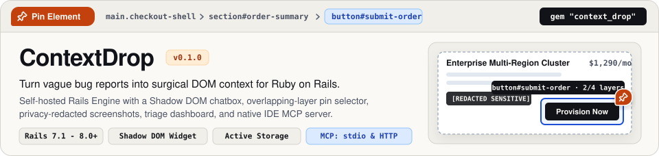
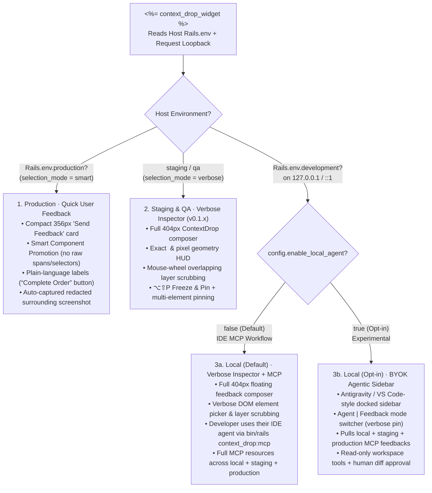
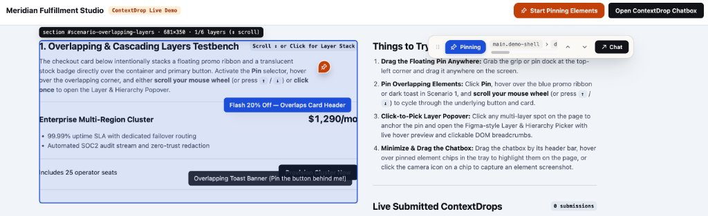
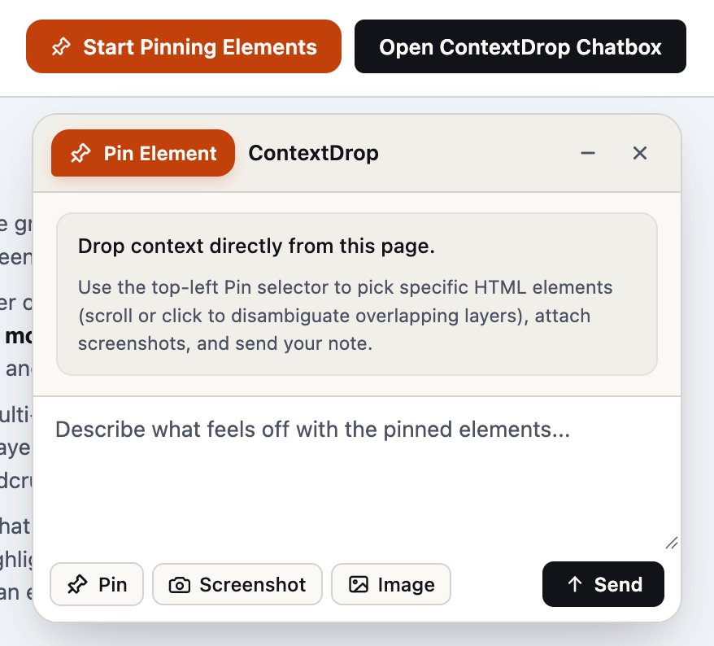
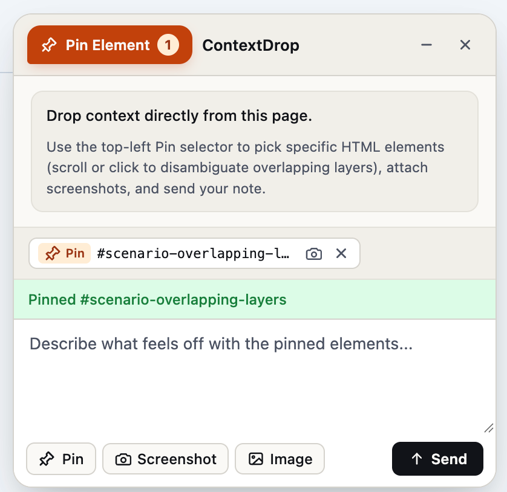
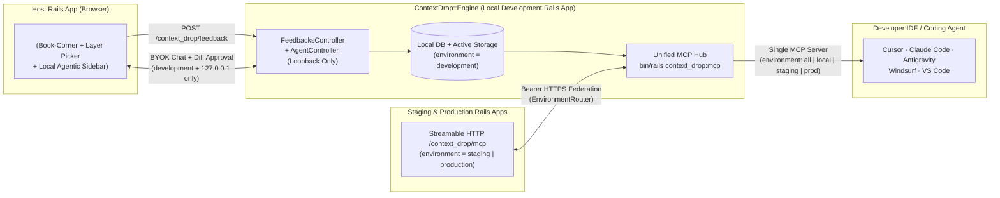
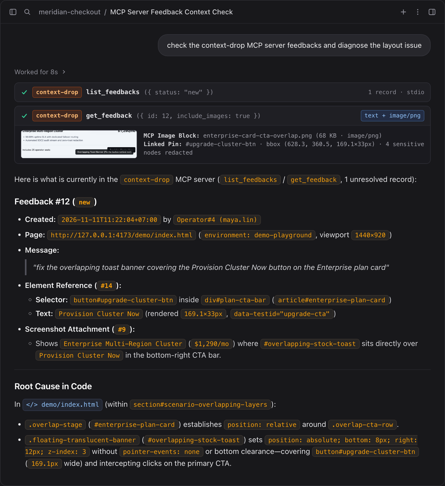

<p align="center">
  
</p>

<p align="center">
  <strong>Stop decoding vague bug reports! Let users pin the problem and fix it right beside your app</strong><br />
  <a href="#nextjs--react-quickstart">Next.js</a> · <a href="#quickstart-ruby-on-rails">Rails</a> · <a href="#mcp">MCP</a>
</p>

<p align="center">
  <a href="https://www.npmjs.com/package/context-drop"></a>
  <a href="https://rubygems.org/gems/context_drop"></a>
  <a href="https://rubygems.org/gems/context_drop"></a>
  <a href="MIT-LICENSE"></a>
</p>

<p align="center">
  <a href="https://www.npmjs.com/package/context-drop">NPM</a> ·
  <a href="https://rubygems.org/gems/context_drop">RubyGems</a> ·
  <a href="#nextjs--react-quickstart">Next.js Quickstart</a> ·
  <a href="#quickstart">Rails Quickstart</a> ·
  <a href="#environment-adaptive-workflow">3-Tier Workflow</a> ·
  <a href="#interactive-playground">Live Demo</a> ·
  <a href="#smart--verbose-element-selection">Smart &amp; Verbose Selectors</a> ·
  <a href="#mcp">Unified MCP Hub</a> ·
  <a href="#zero-trust-privacy--redaction">Privacy &amp; Redaction</a> ·
  <a href="#configuration">Configuration</a>
</p>

---

## Why

When someone reports *"the button on the checkout card isn't working,"* engineers usually spend 20 minutes hunting down which view partial, feature flag, viewport width, or overlapping toast banner caused the problem.

**ContextDrop** (`context_drop`) embeds a tactile, zero-bleed **Shadow DOM book-corner launcher, environment-adaptive selector, and unified multi-environment MCP hub** directly into your Ruby on Rails application (`Rails >= 7.1`, including `Rails 8+`):
- **Minimal Book-Corner Launcher → Peel-to-Pin on Drag:** Rests quietly as a `38×38px` folded page corner. **Click** the book corner to open the feedback form (or, when opted-in locally, the docked Agentic Sidebar); **drag** the book corner to peel and animate it into a live pushpin over any part of the page—or snap it to another viewport corner.
- **3-Tier Environment-Adaptive UX (`production` · `staging` · `local`):** Automatically adapts to `Rails.env`—giving **production** end-users a compact, jargon-free **Smart Component Selector** with automatic surrounding-context screenshots, and giving **staging/QA** teams and **local** developers the verbose `v0.1.x` CSS/layer inspector.
- **MCP-First Workflow for Developers:** Keep your active coding in your preferred editor (**Antigravity**, **Cursor**, **Claude Code**, **VS Code**). Register **one** local MCP server (`bin/rails context_drop:mcp`) in your IDE to query and resolve feedback with multimodal screenshots across `local`, `staging`, and `production` simultaneously.
- **Opt-in Local BYOK Agentic Sidebar:** Want an agent right in the browser? Flip `config.enable_local_agent = true` in development to unlock the docked in-browser agent sidebar with human-approved file diffs.

---

## Environment-Adaptive Workflow

Different environments serve completely different people:
- **Production users** shouldn't be overwhelmed with `#css.selectors`, pixel dimensions (`681×350`), overlapping DOM layer counters, or `<kbd>⌥⇧P</kbd>` shortcuts just to report a bug. They need a rapid, clutter-free way to point at an issue.
- **Staging & QA teams** need surgical leaf/layer inspection, mouse-wheel layer scrubbing, and exact geometry coordinates.
- **Local developers** want two things:
  1. **In-browser testing:** The exact same verbose DOM inspector as staging to verify element pinning and capture payloads on `localhost`.
  2. **Active resolution in their IDE:** Powerful **MCP resources & tools** so their preferred AI coding agents (**Antigravity**, **Cursor**, **Claude Code**, **VS Code**) can query, analyze, and resolve bug reports without forcing development into a browser sidebar. For teams that do want an in-page browser agent, ContextDrop includes an experimental **BYOK Agentic Sidebar** enabled via `config.enable_local_agent = true`.

ContextDrop automatically adapts its UI, copy, and selector behavior from your host `Rails.env` (and loopback connection check) with **zero per-environment view templates**:



### How Each Environment Behaves

| Tier | Host Condition | Surface & Size | Selector Behavior (`selection_mode`) | Screenshot Behavior | Copy & Controls Shown to User |
|---|---|---|---|---|---|
| **1. Production** *(End-Users)* | `Rails.env.production?` | **Compact Quick-Feedback Card** (`356px`, clutter-free) | **`"smart"`** — Coarsely promotes hovered/dropped `<span>`/`<svg>` leaves to the nearest meaningful UI component (button, link, field, card, banner, dialog, row). Single click selects & reopens the form immediately. | **Automatic surrounding context** (`~84px` neighborhood, min `340×220px`, `[REDACTED]`-safe) merged into **one** clean preview card. | Plain human labels (`“Complete Order” button`, `“Enterprise Plan” card`), `Send Feedback`, `Select area`, `Add image`. **Zero CSS selectors, pixel metrics, wheel layer lists, or `<kbd>` badges.** |
| **2. Staging / QA** *(Technical Triage)* | `staging`, `qa`, or non-loopback `development` | **Verbose Inspector Chatbox** (`404px`, `v0.1.x` style) | **`"verbose"`** — Exact leaf/ancestor/overlap inspection with scroll-wheel layer scrubbing (`1/6 layers`), `ArrowUp`/`ArrowDown` stepping, `⌥⇧P` Freeze & Pin, and multi-pin mode. | Manual **Viewport Screenshot** button + per-pin **Element Crop** camera icon (`Shot` & `Pin` chips). | Technical HUD (`button#pay-btn · 180×42`), `Pin Element`, `<kbd>⌥⇧P</kbd>`, `<kbd>Space</kbd>`, `Dropped #42`. |
| **3. Local Development** *(Default · IDE MCP Focus)* | `Rails.env.development?` *(default: `enable_local_agent = false`)* | **Verbose Inspector Chatbox** (`404px`, identical to staging) | **`"verbose"`** — Exact leaf/ancestor inspection, layer scrubbing, and coordinate pinning to test feedback capture locally. | Manual Viewport Screenshot + per-pin Element Crop camera icon. | Technical HUD (`button#pay-btn · 180×42`), `Pin Element`, `<kbd>⌥⇧P</kbd>`, `<kbd>Space</kbd>`. Feedbacks feed directly into your IDE coding agents via `bin/rails context_drop:mcp`. |
| **4. Local Agentic Sidebar** *(Opt-in · Experimental)* | `Rails.env.development?` on loopback **and** `config.enable_local_agent = true` | **Docked BYOK Agentic Coding Sidebar** (`100dvh`, resizable `360–920px`, `Left`/`Right` + Push Layout) | **`"verbose"`** + live workspace file search (`Agent | Feedback` toggle lets you switch between agent and feedback modes). | Attaches live DOM pins & redacted screenshots directly to LLM prompts + pulls remote `staging`/`production` screenshots. | Provider/Model pill, encrypted **BYOK** vault, cross-env **Feedbacks** inbox, tool traces, and human-approved unified diffs (`Apply Change` / `Revert`). |

> [!TIP]
> **Zero Signal Lost in Production!** Even though production users only see friendly labels like `“Complete Order” button` and an automatic surrounding-context screenshot, ContextDrop still captures the full sanitized `selector` (`#checkout-btn`), `dom_path`, `bounding_rect`, `metadata.friendly_label`, and `metadata.original_target_selector` (`span.inner-label`) under the hood—so engineers triaging `production:108` in their IDE via MCP get 100% exact technical coordinates. Need verbose mode in an internal-only production tool (or smart mode in staging)? Override `config.selection_mode = :verbose` or `:smart` in `config/initializers/context_drop.rb`.

<p align="center">
  
</p>

> **Above:** Active **Pin Mode** on the live demo page. While hovering over a stacked UI card (`section #scenario-overlapping-layers · 681×350 · 1/6 layers`), ContextDrop frames the target in Inspector Cobalt, displays layer depth for mouse-wheel cycling, and collapses the chatbox into the **Compact Pinning Bar** (`Pinning`, live DOM ancestor breadcrumbs, Up/Down layer controls, and `Chat` toggle) so the host page stays completely unobstructed.

<table>
  <thead>
    <tr>
      <th width="50%" align="left">1. Click or Peel the Book-Corner Launcher</th>
      <th width="50%" align="left">2. Pin DOM Layers &amp; Capture Element Screenshots</th>
    </tr>
  </thead>
  <tbody>
    <tr>
      <td valign="top">
        
        <p>
          Drop <code>&lt;%= context_drop_widget %&gt;</code> into your layout to render a flush <code>38×38px</code> folded <strong>Book Corner</strong>. Click the corner to open the normal feedback chatbox (or docked local Agentic Sidebar), or drag the corner to morph it into a pushpin and drop it straight onto an element.
        </p>
      </td>
      <td valign="top">
        
        <p>
          Every pinned element is added to the context tray (`#scenario-overlapping-layers`) with a live count badge (`Pin Element 1`). Hover the chip to highlight the element on the page, click the camera icon to crop a screenshot of that exact node, and hit <strong>Send</strong>.
        </p>
      </td>
    </tr>
  </tbody>
</table>

---

## Why ContextDrop

| Capability | Typical SaaS Feedback Widgets | Manual Slack / Issue Reports | **ContextDrop (`context_drop`)** |
|---|---|---|---|
| **Data & Storage Ownership** | Exfiltrates DOM & screenshots to 3rd-party cloud servers | Scattered across chat threads | **100% self-hosted** in your Rails DB (`context_drop_*`) & **Active Storage** |
| **Overlapping DOM Layers** | Gets stuck on topmost wrapper, modal backdrop, or toast | Requires reporter to open DevTools | **Scroll-wheel depth cycling**, **Click-to-Pick Layer Popover**, & **DOM Breadcrumbs** |
| **Host Page Safety** | Injects global CSS; clicks can accidentally fire host buttons | N/A | **Strict Shadow DOM isolation** + capture-phase event suppression during Pin Mode |
| **Sensitive Data Protection** | Captures raw DOM or requires complex PII scrubbing rules | Risk of unredacted screenshots | **Zero-trust redaction** before rasterization (`[data-feedback-sensitive]`, passwords, cards) |
| **Authentication Model** | Separate vendor accounts & seats | Manual identity lookup | **Host-agnostic polymorphic `submitter`** (Devise, Rails 8 Auth, Sorcery, custom, or anonymous) |
| **Developer Resolution Flow** | Copy-paste from external vendor dashboard | Back-and-forth reproduction questions | **Local BYOK Agentic Sidebar** + **Single Unified Multi-Env MCP Server** (`local` + `staging` + `production`) + **Rails Triage Dashboard** |

> [!IMPORTANT]
> **Core Architectural Principle: ContextDrop owns its domain. Your Rails app owns its identity and infrastructure.**  
> ContextDrop mounts cleanly as an isolated Rails Engine (`isolate_namespace ContextDrop`) with zero mandatory frontend framework dependencies (no React, Vue, or Tailwind required).

---

## Next.js & React Quickstart

ContextDrop ships as a **zero-dependency** NPM package ([`context-drop`](https://www.npmjs.com/package/context-drop)) supporting both **standalone full-stack Next.js** (App Router & Pages Router + pluggable storage + `npx context-drop mcp`) and **decoupled Next.js / React frontends** connected to a Ruby on Rails `context_drop` backend.

### 1. Install & Scaffold Route Handler

```bash
npm install context-drop
npx context-drop init
```

`npx context-drop init` auto-detects **App Router** (`app/api/context-drop/[[...path]]/route.ts`) or **Pages Router** (`pages/api/context-drop/[[...path]].ts`) and adds `.context-drop/` to `.gitignore`:

```ts
// app/api/context-drop/[[...path]]/route.ts
import { createContextDropNextHandler } from "context-drop/next/server";

export const { GET, POST, OPTIONS } = createContextDropNextHandler({
  // Zero-config local default stores SQLite/JSON + redacted screenshots in .context-drop/
  mcp: {
    enabled: Boolean(process.env.CONTEXT_DROP_MCP_API_KEY),
    apiKey: process.env.CONTEXT_DROP_MCP_API_KEY
  }
});
```

### 2. Mount `<ContextDrop />` in Your Root Layout

`context-drop/next` includes `"use client"` out of the box—drop `<ContextDrop />` directly into your Server Component `app/layout.tsx` with zero wrapper boilerplate and zero hydration mismatches:

```tsx
// app/layout.tsx
import { ContextDrop } from "context-drop/next";

export default function RootLayout({ children }: { children: React.ReactNode }) {
  return (
    <html lang="en">
      <body>
        {children}
        <ContextDrop
          position="bottom_right"
          metadata={{ release: process.env.NEXT_PUBLIC_VERCEL_GIT_COMMIT_SHA }}
        />
      </body>
    </html>
  );
}
```

Want to open ContextDrop from your own navbar or help menu? Call `useContextDrop()` from any client component:

```tsx
"use client";
import { useContextDrop } from "context-drop/next";

export function ReportBugButton() {
  const { open } = useContextDrop();
  return <button onClick={open}>Report an issue</button>;
}
```

### 3. Connect Your IDE Coding Agent via MCP (`npx context-drop mcp`)

Register **one** unified `stdio` MCP server in `.mcp.json` (Claude Code), `~/.cursor/mcp.json` (Cursor), or `mcp_config.json` (Antigravity / Windsurf). It automatically loads `.env.local` / `.env` and federates `local` + remote `staging` & `production` Next.js (or Rails!) deployments:

```json
{
  "mcpServers": {
    "context-drop": {
      "command": "npx",
      "args": ["context-drop", "mcp"],
      "env": {
        "CONTEXT_DROP_STAGING_MCP_URL": "https://staging.your-app.com/api/context-drop/mcp",
        "CONTEXT_DROP_STAGING_MCP_API_KEY": "your-staging-mcp-bearer-token",
        "CONTEXT_DROP_PRODUCTION_MCP_URL": "https://your-app.com/api/context-drop/mcp",
        "CONTEXT_DROP_PRODUCTION_MCP_API_KEY": "your-production-mcp-bearer-token"
      }
    }
  }
}
```

### 4. Production Storage Adapters (PostgreSQL, S3 / Vercel Blob, or Custom ORM)

Locally, ContextDrop works with zero configuration using Node's built-in SQLite (`node:sqlite`, or atomic JSON fallback) inside `.context-drop/`. For staging and production Next.js deployments (Vercel, Fly, AWS, Render, Railway), plug in `createPostgresStorageAdapter` (compatible with `pg.Pool`, `@vercel/postgres`, Neon, and Supabase) or implement the `StorageAdapter` interface for Prisma / Drizzle:

```ts
// app/api/context-drop/[[...path]]/route.ts
import { Pool } from "pg";
import {
  createContextDropNextHandler,
  createPostgresStorageAdapter
} from "context-drop/next/server";

const pool = new Pool({ connectionString: process.env.DATABASE_URL });

export const { GET, POST, OPTIONS } = createContextDropNextHandler({
  storage: createPostgresStorageAdapter({
    pool,
    autoMigrate: true // Creates context_drop_* tables automatically if missing
    // Optional blobStore: { putBlob, getBlob, deleteBlob } for S3 / R2 / Vercel Blob
  }),
  resolveSubmitter: async (request) => {
    // Optional: attach your NextAuth / Clerk / Supabase user identity
    return null;
  },
  mcp: {
    enabled: true,
    apiKey: process.env.CONTEXT_DROP_MCP_API_KEY
  }
});
```

### 5. Connecting Next.js to a Ruby on Rails Backend

Already running `ContextDrop::Engine` on Rails? Point `<ContextDrop />` at your Rails mount path:
- **Via Next.js Rewrites (Same-Origin, Recommended):** Proxy `/context_drop/:path*` to your Rails API in `next.config.ts` and render `<ContextDrop endpoint="/context_drop" />`.
- **Cross-Origin CORS:** Add `config.allowed_origins = ["http://localhost:3000", "https://app.example.com"]` in `config/initializers/context_drop.rb` and render `<ContextDrop endpoint="https://api.example.com/context_drop" credentials="include" />`.

### NPM Package Exports Reference

| Import Path | Environment | Exports |
|---|---|---|
| `context-drop/next` | Client (`"use client"`) | Next.js `<ContextDrop />`, `<ContextDropWidget />`, `useContextDrop()` (defaults to `/api/context-drop`) |
| `context-drop/next/server` | Node / Server | `createContextDropNextHandler`, `createContextDropPagesHandler`, `createContextDropFetchHandler`, `createLocalStorageAdapter`, `createPostgresStorageAdapter`, `createMemoryStorageAdapter` |
| `context-drop/react` | Client (`"use client"`) | Framework-agnostic React `<ContextDrop />`, `useContextDrop()` (defaults to `/context_drop`) |
| `context-drop/mcp` | Node / Server | `createContextDropMcpServer`, `runContextDropMcpStdio`, `ContextDropMcpDispatcher`, `EnvironmentRouter` |
| `context-drop/widget` | Browser | Auto-registering `<context-drop-widget>` Web Component & `ContextDropApiClient` |
| `context-drop/bundle` | Browser IIFE | Self-contained `<script>` bundle (`context_drop.js`) |
| `npx context-drop` | CLI | `npx context-drop mcp` (stdio MCP server) & `npx context-drop init` (Next.js scaffolder) |

---

## Quickstart (Ruby on Rails)

### Requirements

- **Ruby** `>= 3.1`
- **Ruby on Rails** `>= 7.1` (`7.1`, `7.2`, `8.0+`)
- **Active Storage** installed in the host application (`bin/rails active_storage:install`)

### 1. Install the Gem & Run the Generator

Install [`context_drop` from RubyGems.org](https://rubygems.org/gems/context_drop) (or add `gem "context_drop"` to your `Gemfile`):

```bash
bundle add context_drop
bin/rails generate context_drop:install
bin/rails db:migrate
```

What `bin/rails generate context_drop:install` sets up for you:
1. Creates [`config/initializers/context_drop.rb`](lib/generators/context_drop/install/templates/initializer.rb.tt).
2. Mounts `mount ContextDrop::Engine => "/context_drop"` in `config/routes.rb`.
3. Copies four engine-owned migrations (`context_drop_feedbacks` with `environment` attribution, `context_drop_element_references`, `context_drop_attachments`) into `db/migrate/`.
4. Verifies that Active Storage migrations are present.

### 2. Render the Widget in Your Layout

Add `<%= context_drop_widget %>` right before `</body>` in `app/views/layouts/application.html.erb`:

```erb
<%= context_drop_widget %>
```

Need page-specific copy or release metadata? Override options per view without mutating global configuration:

```erb
<%= context_drop_widget(
  position: :bottom_left,
  placeholder: "Spot an issue with checkout? Pin the element and let us know...",
  metadata: { release: ENV["GIT_COMMIT_SHA"], feature_flag: "checkout_v2" }
) %>
```

### 3. Enable & Launch

```bash
export CONTEXT_DROP_ENABLED=true
bin/rails server
```

Visit any page in your Rails app to use the floating widget, or open `/context_drop/dashboard/feedbacks` to triage submissions.

---

## Interactive Playground

Want to test all three environment modes (`local (Agent)` · `staging (Verbose)` · `production (Smart)`), peel-to-pin corner dragging, smart component promotion with auto surrounding screenshots, overlapping-layer disambiguation, and the live payload inspector before installing the gem into a Rails app? Run the standalone playground in this repository:

```bash
# Start the local interactive demo server at http://127.0.0.1:4173
npm run demo

# Or open demo/index.html directly in your browser (works offline via built-in payload interceptor)
open demo/index.html
```

Use the top-bar switcher in the demo to flip live between **Local (Agent Sidebar)**, **Staging (Verbose Inspector)**, and **Production (Smart Quick-Feedback)**.

---

## Feedback-to-Fix Loop



Every submission captures a rich, sanitized engineering payload:
- **`ContextDrop::Feedback` (`context_drop_feedbacks`):** Automatic host `environment` (`Rails.env`—e.g. `development`, `staging`, `production`), polymorphic `submitter` (`User`, `Employee`, `AdminUser`, or anonymous), `message`, `page_url`, `user_agent`, `viewport` & custom `metadata`, and workflow `status` (`new`, `reviewed`, `resolved`, `dismissed`).
- **`ContextDrop::ElementReference` (`context_drop_element_references`):** Point-in-time DOM snapshot including `tag_name`, best-effort CSS `selector`, structural `dom_path`, truncated `text_content`, allowlisted `attributes_snapshot` (`id`, `class`, `role`, `aria-*`, `data-testid`), and CSS pixel `bounding_rect` (`{ x, y, width, height }`).
- **`ContextDrop::Attachment` (`context_drop_attachments`):** Viewport screenshots, element-cropped screenshots (linked via `element_reference_id`), and uploaded images stored in your app's **Active Storage**.

---

## Smart & Verbose Element Selection

ContextDrop stays tucked away as a `38×38px` folded **Book Corner** until needed—**click** the corner to open the feedback surface, or **drag** the corner to peel and morph it into a pushpin over any part of the page (or drop it into another viewport corner to re-dock). All `pointerdown`, `mousedown`, `mouseup`, and `click` events are intercepted in the capture phase while selecting so host links, buttons, and forms never fire by mistake.

Once selecting, ContextDrop tailors precision and verbosity to the active environment (`config.selection_mode = :auto`):

### 1. Production: Smart Component Selector (`selection_mode = "smart"`)

Optimized for speed, compactness, and non-technical end-users—being slightly coarse on hover is intentional because ContextDrop pairs the component with a wide neighborhood screenshot:
- **Automatic Component Promotion:** Hovering or dropping on inner leaf nodes (`<span>`, `<svg>`, `<strong>`, icon wrappers) automatically promotes the highlight to the nearest meaningful UI unit—such as a `button`, `link`, `input` field, `card`, `banner`, `dialog`, `form`, `navigation` bar, `table row`, or bounded `section`.
- **Plain-Language Labels Only:** The hover pill and composer show human-friendly descriptions (`“Complete Order” button`, `“Enterprise Plan” card`)—never `#id.class` strings, `681×350` pixel readouts, layer counters, wheel-scrubbing interception, or `<kbd>` shortcut hints.
- **Automatic Surrounding-Context Screenshot:** A single click selects the component, automatically captures a privacy-redacted neighborhood screenshot (`smart_capture_padding = 84`, minimum `340×220px` clamped to viewport, framing the target component in Pin Vermilion), merges both into **one** clean preview card, and immediately reopens the compact `356px` **Send Feedback** form.
- **Full Technical Fidelity Preserved:** Under the hood, the submitted `ElementReference` still records the exact sanitized `selector`, `dom_path`, `bounding_rect`, `metadata.friendly_label`, `metadata.component_kind`, and `metadata.original_target_selector` alongside the linked `Attachment`.

### 2. Staging, QA & Dev: Verbose Layer Inspector (`selection_mode = "verbose"`, `v0.1.x` Format)

Optimized for QA engineers, designers, and developers debugging dense, overlapping layouts (sticky navbars, floating ribbons, translucent toasts, nested Flexbox/Grid wrappers):
- **Exact `<tag#id.class>` & Geometry HUD:** Displays exact tag/selector identifiers, `tabular-nums` pixel dimensions (`681×350`), and overlapping candidate depth (`1/6 layers`).
- **Scroll-Wheel & Keyboard Depth Scrubbing:** Roll your mouse wheel (`wheel`) or press `ArrowUp` / `ArrowDown` (`[` / `]`) over any coordinate to cycle through `document.elementsFromPoint` overlapping layers, child nodes, and parent containers while keeping a dashed ghost outline on the original leaf node.
- **Freeze & Pin Transient Menus (`⌥⇧P`):** Press `Alt+Shift+P` (`⌥⇧P`) while a hover dropdown or tooltip is open to freeze the page coordinate and scrub/pin transient layers, or press `Space` / click to pin multiple elements in a single pass.

---

## Local BYOK Agentic Sidebar (`development` Opt-in)

> [!NOTE]
> **MCP-First Workflow by Default:** In v0.2.0, local development defaults to the **staging/verbose DOM inspector** (`config.enable_local_agent = false`) so you can test element pinning and feed bug reports directly to your preferred AI coding agent in your IDE (**Antigravity**, **Cursor**, **Claude Code**, **VS Code**) via the unified MCP server.
>
> If you prefer an integrated in-browser coding assistant, set `config.enable_local_agent = true` (or `CONTEXT_DROP_LOCAL_AGENT_ENABLED=true`) to enable the embedded sidebar.

When enabled (`config.enable_local_agent = true`) and running locally (`Rails.env.development?` on `localhost` / `127.0.0.1`), clicking or peeling the Book-Corner transforms ContextDrop into a full-height, resizable **Agentic Coding Sidebar**—similar to the coding sidebars in **Antigravity** and **VS Code**:

- **Dual `Agent | Feedback` Mode Switcher:** Triage bugs and edit local Rails code in **Agent** mode, or flip to **Feedback** mode at any time to preview and submit through the standard floating feedback chatbox.
- **Flexible Docked Layout:** Dock to the **Right** or **Left** edge, drag the resize handle (`360px–920px`, defaulting to `560px`), and toggle **Push Page Layout** so the sidebar sits side-by-side with your running app without covering content.
- **Dark & Light Theme Support:** Click the sun/moon switcher in the top bar to toggle between the crisp off-white light theme and the deep charcoal dark theme (`theme: :dark` or `data-theme="dark"`).
- **Cross-Environment Context Attachment:** Peel-and-drop live DOM elements and redacted screenshots from the current page, **and** attach bug reports directly from `local`, `staging`, or `production` via the built-in **Feedback Inbox** drawer.
- **Bring Your Own Key (BYOK):** Supports **Anthropic** (`Claude`), **Google Gemini**, **OpenAI**, and **Custom OpenAI-Compatible** endpoints (OpenRouter, Groq, Ollama, vLLM). Automatically detects local server environment variables (`ANTHROPIC_API_KEY`, `GEMINI_API_KEY` / `GOOGLE_API_KEY`, `OPENAI_API_KEY`, `CONTEXT_DROP_LLM_API_KEY`), or saves keys you enter in the sidebar's **BYOK Vault** drawer encrypted on disk (`AES-256-GCM`, mode `0600`) inside gitignored `tmp/context_drop_byok.enc`.

### Defense-in-Depth Local Agent Safety

Because user-submitted feedback messages from `staging` or `production` are untrusted input, the Local Agentic Sidebar enforces five strict security walls:
1. **Hard-Blocked Outside Local Development:** `/context_drop/agent/*` returns `404 Not Found` whenever `Rails.env.production?` is true, when `local_agent_enabled` is false, or when a request does not originate from strict loopback (`127.0.0.1` / `::1`) with a loopback `Host` header, same-origin headers, CSRF token, and `authorize_dashboard` permission.
2. **Zero Browser Key Exposure:** API keys are **never** stored in `localStorage`, `sessionStorage`, cookies, or DOM attributes. Input fields are wiped immediately upon save, and `/agent/status` returns only masked tails (`••••••••7f9a`).
3. **Workspace Root Jail & Secret Denylist:** File tools (`list_workspace_files`, `search_workspace`, `read_workspace_file`, `propose_file_edit`) enforce `File.realpath` containment inside `Rails.root` and block `.env*`, `config/master.key`, `config/credentials*`, `*.pem`, `*.key`, `tmp/context_drop_byok*`, `.git/config`, and `.git/hooks/*`.
4. **No Arbitrary Shell Execution:** No `bash` / `sh` / `system` tool is exposed to LLM tool calls, eliminating prompt-injection command execution.
5. **Human-Approved Inline Diffs + 1-Click Revert:** Proposed file edits are staged in memory and rendered as unified diff cards (`+N / -N`). Disk writes occur **only** when you click **Apply Change** (guarded by SHA-256 pre-image verification), with 1-click **Revert** afterward.

---

## MCP

ContextDrop ships with a built-in **Model Context Protocol (MCP)** server (`ContextDrop::MCP::Server`) so you or your AI coding agent can pull bug reports, inspect exact CSS selectors and DOM paths, view multimodal screenshots, and mark issues resolved without leaving your editor.

<p align="center">
  
</p>

> **Above:** Triage flow inside an AI coding agent connected to the `context-drop` MCP server on the live playground. The agent invokes `list_feedbacks` (`{ status: "new" }`) and `get_feedback` (`{ id: 12, include_images: true }`), inspects both the structured `ElementReference` geometry (`button#upgrade-cluster-btn`, `169.1×33px`) and the redacted multimodal `image/png` screenshot block, and pinpoints the exact overlapping CSS rule in `demo/index.html`.

### Exposed MCP Capabilities

| Type | Name / URI | Description |
|---|---|---|
| **Tool** | `list_environments` | List `local` (with current host `Rails.env`) plus all configured remote environments (`staging`, `production`, etc.) and connection status. |
| **Tool** | `list_feedbacks` | Filter & paginate submissions across `environment` (`"all"`, `"local"`, `"staging"`, `"production"`), `status` (`new`, `reviewed`, `resolved`, `dismissed`), `page_url`, or free-text `query`. Returns qualified IDs (`local:12`, `production:42`). |
| **Tool** | `get_feedback` | Fetch full `Feedback`, all `ElementReference` DOM snapshots, and inline base64 `image` blocks by `id` + `environment` or qualified ID (`"production:42"`). |
| **Tool** | `get_feedback_attachment` | Retrieve an individual local or remote `Attachment` record and its binary screenshot/image as an MCP `image` content block. |
| **Tool** | `update_feedback_status` | Transition a local or remote feedback record between `new`, `reviewed`, `resolved`, and `dismissed`. |
| **Resource** | `contextdrop://feedbacks/new` | Live JSON feed of unresolved `new` feedback records (up to 50 most recent). |
| **Resource** | `contextdrop://feedbacks/{id}` | Full JSON snapshot of a specific feedback submission, its pinned elements, and attachment metadata. |
| **Prompt** | `investigate_feedback` | Generates a structured root-cause investigation brief (with attached screenshots) for any local or remote `feedback_id` (`"staging:18"`). |

---

### Recommended Setup: One Unified MCP Server for All Environments (`local` + `staging` + `production`)

Instead of registering separate MCP servers per environment in your IDE, register **a single `context-drop` server** running `./bin/rails context_drop:mcp`. It automatically reads your local development database (`local`) **and** federates every remote environment configured in `config.mcp_environments` or `CONTEXT_DROP_<ENV>_MCP_URL` / `CONTEXT_DROP_<ENV>_MCP_API_KEY`:

```json
{
  "mcpServers": {
    "context-drop": {
      "command": "/bin/zsh",
      "args": [
        "-c",
        "cd /absolute/path/to/your-rails-app && exec /Users/<you>/.rbenv/shims/bundle exec ./bin/rails context_drop:mcp"
      ],
      "env": {
        "PATH": "/Users/<you>/.rbenv/shims:/Users/<you>/.rbenv/bin:/opt/homebrew/bin:/usr/local/bin:/usr/bin:/bin:/usr/sbin:/sbin",
        "CONTEXT_DROP_STAGING_MCP_URL": "https://staging.example.com/context_drop/mcp",
        "CONTEXT_DROP_STAGING_MCP_API_KEY": "<staging-mcp-secret-token>",
        "CONTEXT_DROP_PRODUCTION_MCP_URL": "https://app.example.com/context_drop/mcp",
        "CONTEXT_DROP_PRODUCTION_MCP_API_KEY": "<production-mcp-secret-token>"
      }
    }
  }
}
```

> [!NOTE]
> **Prefer keeping URLs/tokens in Rails credentials or `.env.development.local`?** You can omit the `CONTEXT_DROP_*_MCP_*` entries from your IDE JSON entirely and configure `config.mcp_environments` inside `config/initializers/context_drop.rb`—both your IDE's `context-drop` MCP server and the in-browser Local Agentic Sidebar share the exact same `EnvironmentRouter`.

With one unified server registered in **Antigravity** (`mcp_config.json`), **Cursor** (`~/.cursor/mcp.json`), **Claude Code** (`.mcp.json`), **Windsurf**, or **VS Code**, you can ask naturally across environments:
- *"List new feedbacks across `all` environments on `context-drop`, inspect `production:42` with its screenshot, fix the CSS/ERB locally, and mark `production:42` resolved."*
- *"Check `local` feedbacks I just pinned and verify the layout fix."*

---

### Recommended Environment Matrix

| Environment | Host `Rails.env` Attribution | `CONTEXT_DROP_ENABLED` (Widget & Dashboard) | `CONTEXT_DROP_MCP_ENABLED` (HTTP `/mcp`) | Widget Surface, Selector Mode & MCP Role |
|---|---|---|---|---|
| **Local (`development`)** | `"development"` *(loopback `127.0.0.1` / `::1`)* | `true` | `false` *(not needed for `stdio` hub)* | **Book-Corner + Local BYOK Agentic Sidebar** (`Agent \| Feedback` toggle, `selection_mode: "verbose"`); runs the single unified `stdio` MCP hub (`context_drop:mcp`). |
| **Staging / QA** | `"staging"` | `true` | `true` | **Book-Corner + Verbose Inspector Chatbox** (`selection_mode: "verbose"`, `v0.1.x` CSS/layer HUD); federated into local MCP hub via dedicated `staging` Bearer token. |
| **Production** | `"production"` | `true` *(or scoped via `authorize_submission`)* | `true` | **Book-Corner + Compact Smart Quick-Feedback** (`selection_mode: "smart"`, plain-language component labels + auto surrounding screenshot; Agent endpoints hard-locked `404`); federated into local MCP hub via dedicated `production` Bearer token. |

#### Multi-Environment Best Practices

- **Automatic Host Environment Stamping:** Every `ContextDrop::Feedback` record automatically stamps `Rails.env` (customizable via `config.environment`)—no manual metadata boilerplate required, though you can still pass `metadata: { release: ENV["GIT_COMMIT_SHA"] }` to `<%= context_drop_widget(...) %>`.
- **Isolate secrets per environment:** Generate a distinct high-entropy `CONTEXT_DROP_MCP_API_KEY` (`bin/rails secret` or `openssl rand -hex 32`) in each deployed environment's Rails encrypted credentials or secret manager. Never share a single Bearer token between staging and production.
- **HTTPS Enforced for Remote Endpoints:** `ContextDrop::MCP::RemoteClient` enforces `https://` by default for all non-loopback remote MCP URLs and sets `allow_Cross_Origin` / redirect limits to zero so Bearer tokens are never leaked across redirects.
- **Independent Widget vs. MCP switches:** `config.enabled` and `config.mcp_enabled` are decoupled—`ContextDrop::McpController` remains reachable whenever `CONTEXT_DROP_MCP_ENABLED=true`, even if you temporarily set `CONTEXT_DROP_ENABLED=false` in production to pause new widget submissions while finishing triage.
- **Layer zero-trust proxy headers when needed:** If your remote MCP endpoints sit behind Cloudflare Access, Google IAP, or an internal MCP gateway, pass additional proxy `"headers"` inside `config.mcp_environments` alongside `api_key` (or validate custom JWT/header claims in `config.authorize_mcp`).

---

### Alternative Transport Options & Ruby Version Manager Reference

If you run a workspace-scoped config where your shell `PATH` is already inherited, or if you run inside Docker / remote-only environments, use the reference snippets below.

#### Option 1: Minimal Workspace-Scoped `stdio` (With `config.mcp_environments` in Rails)

When your IDE runs inside the Rails root, inherits your Ruby `PATH`, and remote environments are already configured in `config/initializers/context_drop.rb` or `.env.development.local`:

```json
{
  "mcpServers": {
    "context-drop": {
      "command": "bundle",
      "args": ["exec", "./bin/rails", "context_drop:mcp"]
    }
  }
}
```

#### Option 2: Strict Sandboxes, Global IDE Configs & Ruby Version Managers (`rbenv`, `mise`, `asdf`, `rvm`)

Strict sandboxed coding agents and GUI-launched desktop IDEs (such as **Antigravity** `mcp_config.json`, **Claude Desktop**, global `~/.cursor/mcp.json`, **Windsurf**, or VS Code launched from macOS Finder / Linux desktop) typically spawn MCP subprocesses with:
1. **A non-project working directory** (often `/` or `$HOME`, causing relative `./bin/rails` or `Gemfile` lookup to fail), and
2. **A stripped minimal `PATH`** (`/usr/bin:/bin:/usr/sbin:/sbin`) without sourcing `~/.zshrc` or `~/.bashrc`—causing `/usr/bin/env ruby` inside `bin/rails` to hit an outdated system Ruby (e.g., macOS Ruby `2.6`) or fail to locate `bundle` and Homebrew native libraries (`libpq`, `sqlite3`, `vips`).

Wrap the unified `context-drop` server command with `/bin/zsh -c` (or `/bin/bash -c` on Linux), `cd` into your Rails application root, `exec` your version manager's `bundle` binary directly, and declare an explicit absolute `PATH`:

```json
{
  "mcpServers": {
    "context-drop": {
      "command": "/bin/zsh",
      "args": [
        "-c",
        "cd /absolute/path/to/your-rails-app && exec /Users/<you>/.rbenv/shims/bundle exec ./bin/rails context_drop:mcp"
      ],
      "env": {
        "PATH": "/Users/<you>/.rbenv/shims:/Users/<you>/.rbenv/bin:/opt/homebrew/bin:/usr/local/bin:/usr/bin:/bin:/usr/sbin:/sbin"
      }
    }
  }
}
```

> [!TIP]
> **Adapting Option 2 to any machine or Ruby version manager:**
> - **Use literal absolute paths (avoid `~` or `$HOME` inside JSON `env`):** MCP hosts pass `env` directly to `execve` without shell expansion. Run `pwd`, `which bundle`, and `echo $PATH` in your Rails app terminal to get your exact paths.
> - **Keep `exec` before `bundle`:** `exec` replaces the `zsh`/`bash` wrapper in-place so `stdin`/`stdout` JSON-RPC frames remain unbuffered and IDE shutdown signals (`SIGTERM`) cleanly terminate the Ruby process without leaving orphans.
> - **Debug `stdio` boot issues:** Set `"CONTEXT_DROP_MCP_DEBUG": "1"` inside `"env"` to stream verbose Rails/ActiveRecord boot diagnostics to `stderr` (MCP `stdout` always stays strictly reserved for JSON-RPC frames).

| Ruby Environment / OS | `<bundle-path>` for `exec` | Directories to Prepend to `env.PATH` |
|---|---|---|
| **`rbenv`** (macOS / Linux) | `/Users/<you>/.rbenv/shims/bundle` | `/Users/<you>/.rbenv/shims:/Users/<you>/.rbenv/bin` |
| **`mise`** (macOS / Linux) | `/Users/<you>/.local/share/mise/shims/bundle` | `/Users/<you>/.local/share/mise/shims` |
| **`asdf`** (macOS / Linux) | `/Users/<you>/.asdf/shims/bundle` | `/Users/<you>/.asdf/shims:/Users/<you>/.asdf/bin` |
| **`rvm`** (macOS / Linux) | `/Users/<you>/.rvm/wrappers/default/bundle` | `/Users/<you>/.rvm/gems/default/bin:/Users/<you>/.rvm/bin` |
| **Homebrew / Linux `/usr/local`** | `/opt/homebrew/opt/ruby/bin/bundle` or `/usr/local/bin/bundle` | `/opt/homebrew/opt/ruby/bin:/opt/homebrew/bin:/usr/local/bin` |

#### Option 3: Streamable HTTP Transport (Docker, Isolated Sandboxes, Staging & Production)

If your Rails app runs inside **Docker / Devcontainers**, if your agent sandbox blocks host binary execution outside the workspace, or if you want to triage feedback directly from **staging or production**, enable the HTTP endpoint with a bearer token (`CONTEXT_DROP_MCP_ENABLED=true` and `CONTEXT_DROP_MCP_API_KEY=<your-secret-token>`) and point your MCP client to `POST /context_drop/mcp`:

```json
{
  "mcpServers": {
    "context-drop-remote": {
      "url": "https://staging.example.com/context_drop/mcp",
      "headers": {
        "Authorization": "Bearer <your-secret-token>"
      }
    }
  }
}
```

*(For local Docker or strict-sandbox setups, use `"url": "http://localhost:3000/context_drop/mcp"` against your running `bin/rails server`.)*

---

## Zero-Trust Privacy & Redaction

ContextDrop is engineered for production environments where customer privacy and credential safety are non-negotiable:

- **Declarative Redaction Attributes:** Add `data-feedback-sensitive` or `data-feedback-ignore` to any HTML element. ContextDrop blocks the element (and **all of its descendants**) from being pinned and masks its bounding box with an opaque redaction block *before* any screenshot is rasterized:
  ```html
  <div data-feedback-sensitive>
    <span>Account Balance: $42,100.00</span>
    <span>Card ending in 4242</span>
  </div>
  ```
- **Automatic Credential & Card Exclusions:** `input[type="password"]`, `input[type="hidden"]`, and `[autocomplete^="cc-"]` are always excluded and redacted automatically.
- **No Raw DOM or Input Value Leaks:** Form control `value` properties and raw `outerHTML` are **never** serialized. Only allowlisted structural attributes (`id`, `class`, `role`, `aria-*`, `data-testid`, `name`, `type`, `href`) are stored.
- **Server-Side Upload Hardening:** Binary attachments are verified via magic-byte MIME detection (`Marcel`), extension matching, byte-size limits, image dimension bounds, CSRF protection, and configurable rate limiting.

---

## Triage Dashboard

ContextDrop includes a triage interface mounted inside your Rails application at `/context_drop/dashboard/feedbacks`:

- **Filter & Search:** Filter submissions by status (`new`, `reviewed`, `resolved`, `dismissed`), originating `page_url`, or free-text query across messages, CSS selectors, and DOM paths.
- **Inspect Context:** View submitter attribution, browser/viewport metadata, inline Active Storage screenshot galleries, and structured `ElementReference` cards (`selector`, `dom_path`, `bounding_rect`, `attributes_snapshot`).
- **Triage Actions:** Transition feedback status between `Mark Reviewed`, `Mark Resolved`, and `Dismiss`.

---

## Configuration

Customize every aspect of ContextDrop in `config/initializers/context_drop.rb`:

```ruby
ContextDrop.configure do |config|
  # Master switch (disables widget helper, dashboard, and HTTP ingestion endpoints when false)
  config.enabled = ENV.fetch("CONTEXT_DROP_ENABLED", "false") == "true"

  # Host environment attribution (defaults automatically to Rails.env)
  # config.environment = Rails.env

  # Initial book-corner launcher position: :bottom_right, :bottom_left, :top_right, :top_left
  config.position = :bottom_right

  # Element selection UX mode:
  # - :auto (default) -> "smart" (jargon-free component promotion + auto surrounding screenshot) in production,
  #                      "verbose" (v0.1.x CSS selector HUD, wheel layer scrubbing & ⌥⇧P shortcuts) in staging/dev
  # - :smart          -> force compact plain-language component selector + auto surrounding screenshot
  # - :verbose        -> force technical CSS selector HUD, wheel layer scrubbing, and multi-pin inspector
  config.selection_mode = :auto
  config.smart_capture_padding = 84

  # Local development BYOK Agentic Sidebar (strictly active only in `development` on 127.0.0.1 / ::1)
  # Disabled by default in v0.2.0; local development defaults to the verbose inspector modal
  # so developers can test DOM pinning and use their preferred IDE coding agents (Antigravity, Cursor, etc.) via MCP.
  # Enable if you want the experimental in-browser agent sidebar:
  config.enable_local_agent = ENV.fetch("CONTEXT_DROP_LOCAL_AGENT_ENABLED", "false") == "true"

  # Allow unauthenticated visitors to submit feedback
  config.allow_anonymous = true

  # Polymorphic submitter attribution, return any ActiveRecord model (User, Employee, AdminUser) or nil
  config.current_submitter = ->(controller) { controller.try(:current_user) }

  # Authorization hooks
  config.authorize_submission = ->(_controller) { true }
  config.authorize_dashboard = ->(controller) {
    controller.try(:current_user)&.try(:admin?) || Rails.env.development?
  }

  # Limits & upload validation
  config.max_attachments = 10
  config.max_element_references = 10
  config.max_attachment_size = 10.megabytes
  config.allowed_content_types = %w[image/png image/jpeg image/webp image/gif]
  config.max_image_dimensions = [4096, 4096]

  # Additional CSS selectors to exclude from DOM selection and redact in screenshots
  config.excluded_selectors = [
    "[data-feedback-ignore]",
    "[data-feedback-sensitive]",
    "input[type='password']",
    "input[type='hidden']",
    "[autocomplete^='cc-']"
  ]

  # Lifecycle callback invoked after feedback persistence (ideal for Slack, Linear, or GitHub webhooks)
  config.on_feedback_created = ->(feedback) {
    Rails.logger.info("New ContextDrop Feedback ##{feedback.id} (#{feedback.environment}) on #{feedback.page_url}")
  }

  # Unified Model Context Protocol (MCP) Server settings
  config.mcp_enabled = ENV.fetch("CONTEXT_DROP_MCP_ENABLED", "false") == "true"
  config.mcp_api_key = ENV["CONTEXT_DROP_MCP_API_KEY"]
  config.authorize_mcp = nil

  # Federated remote environments queried by your single local `bin/rails context_drop:mcp` hub
  # (also auto-discovers CONTEXT_DROP_<ENV>_MCP_URL + CONTEXT_DROP_<ENV>_MCP_API_KEY env variables):
  config.mcp_environments = {
    staging: {
      url: ENV["CONTEXT_DROP_STAGING_MCP_URL"],
      api_key: ENV["CONTEXT_DROP_STAGING_MCP_API_KEY"]
    },
    production: {
      url: ENV["CONTEXT_DROP_PRODUCTION_MCP_URL"],
      api_key: ENV["CONTEXT_DROP_PRODUCTION_MCP_API_KEY"]
    }
  }
end
```

---

## Contributing & Development

```bash
# Build the decoupled TypeScript widget into app/assets/javascripts/context_drop/context_drop.js
npm run build

# Run frontend TypeScript unit & interaction tests
npm test

# Run backend Ruby engine & MCP specs
ruby spec/run_all.rb

# Bump synchronized Gem + NPM version and cut a signed unified release (GitHub + RubyGems + NPM)
bundle exec rake "version:bump[0.2.1]"
bundle exec rake release
```

Further architectural documentation:
- [Technical Specification (`SPEC.md`)](SPEC.md)
- [Design System (`DESIGN.md`)](DESIGN.md)
- [Product Brief (`PRODUCT.md`)](PRODUCT.md)

## License

Released under the [MIT License](MIT-LICENSE).
