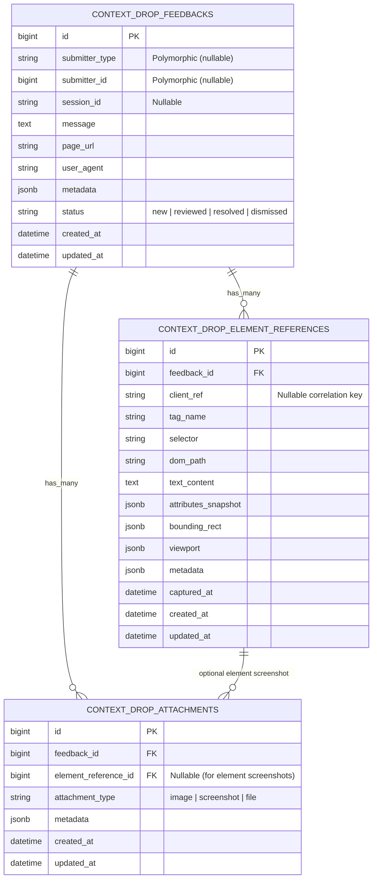

# ContextDrop — Technical Specification

**Status:** Draft (v0.1.0-spec)  
**Project Type:** Open-source Ruby Gem (`context_drop`)  
**Architecture:** Mountable Ruby on Rails Engine (`isolate_namespace ContextDrop`) + Decoupled TypeScript Frontend Widget + MCP Server  
**License:** MIT (Proposed / TBD)  
**Working Name:** ContextDrop  

> **Core Design Principle:**  
> **ContextDrop owns its domain. The host application owns its identity and infrastructure.**  
> ContextDrop functions as an independent, self-contained subsystem inside the host Rails application without knowing whether the host uses Devise, Sorcery, Authlogic, Rails 8 built-in authentication, or custom session logic.

---

## 1. Overview

**ContextDrop** is a self-hosted contextual feedback library for Ruby on Rails applications.

It provides an embeddable feedback interface inspired by modern AI prompt composers, an engine-owned persistence layer, a built-in self-hosted triage dashboard, and a Model Context Protocol (MCP) server for IDEs. Users can submit natural-language feedback while attaching visual and structural context from the application page they are currently using.

Users can:
- Describe bugs, UX issues, feature requests, or general feedback in a multiline prompt composer.
- Upload images as supporting evidence.
- Capture screenshots of the current browser viewport or specific DOM elements.
- Select individual DOM elements interactively and attach them to feedback.
- Attach multiple files, screenshots, and DOM element references to a single feedback submission.

ContextDrop stores feedback, attachments, and element references in **engine-owned database tables** and binary files in the host application's **Active Storage**. It requires **no external SaaS account, hosted backend, or AI provider**.

---

## 2. Goals & Non-Goals

### 2.1 Primary Goals

1. **Encapsulated Mountable Engine:** Keep all feedback functionality encapsulated inside the gem (models, persistence, submission controllers, self-hosted dashboard views, attachment handling, routes, and JavaScript widget).
2. **Prompt-Style UX:** Make feedback submission feel as fluid and intuitive as interacting with an AI prompt composer.
3. **High-Signal Context Preservation:** Preserve the visual state (screenshots), viewport geometry, URL, and sanitized DOM metadata (`ElementReference`) surrounding user feedback.
4. **Dual-Environment Support:** Support both internal employee applications (authenticated) and public-facing customer applications (authenticated or anonymous).
5. **Clean Ownership Boundary:** Own dedicated, namespaced database tables and migrations (`context_drop_*`) while delegating user identity, authentication, authorization policies, and physical database/storage infrastructure to the host application.
6. **Minimal Integration Effort:** Installable via standard Rails generators (`bin/rails generate context_drop:install`) and an explicit view helper (`<%= context_drop_widget %>`).
7. **IDE & Agent Ready (Phase 2):** Provide an MCP server (`stdio` and HTTP) so developers and coding agents can query feedback, inspect screenshots/selectors, and resolve issues directly from their IDE.

### 2.2 Non-Goals (Initial Release)

The initial release (`v0.1.0`) will **not** provide:
- An external hosted feedback collection service or multi-tenant cloud SaaS dashboard.
- Project management or sprint planning functionality.
- Built-in third-party issue tracker integrations (Jira, Linear, GitHub Issues — supported via callbacks instead).
- AI-powered categorization or summarization.
- Session replay or continuous screen recording.
- Real-time collaborative feedback.
- Automatic bug reproduction.
- A user-facing conversation history.

---

## 3. Target Environments & Users

| Environment | Primary Users | Typical Use Cases | Identity Model |
|---|---|---|---|
| **Internal Applications** | Employees, QA, Operations, Support | Application bugs, confusing workflows, data inconsistencies, missing functionality, operational issues | Authenticated submitter linked via polymorphic `submitter` (`User`, `Employee`, `AdminUser`, etc.) |
| **Public-Facing Applications** | Customers, beta testers, guests | UI problems, checkout issues, unexpected behavior, feature requests, general product feedback | Authenticated customer or anonymous submission (`allow_anonymous = true`) |

The host application remains responsible for deciding whether authentication is required for submission and who is authorized to access the engine's feedback dashboard or retrieval APIs.

---

## 4. User Experience

### 4.1 Floating Feedback Button

ContextDrop provides a floating trigger button on configured application pages:
- **Default Position:** `:bottom_right` (configurable to `:bottom_left`, `:top_right`, `:top_left`).
- **Positioning:** `position: fixed` relative to the viewport.
- **Behavior:** Opens the feedback composer when clicked or activated via keyboard; can be dismissed without submitting (`Escape` or close button); does not interfere with the host application's existing interactions.

### 4.2 Feedback Composer

The composer uses a prompt-style interface containing:
- A multiline text input (default placeholder: `"What would you like to tell us?"`).
- An image attachment control (file picker, drag-and-drop, clipboard paste).
- A visual DOM element selection control.
- A screenshot capture control.
- A submission action (`Cmd/Ctrl+Enter` or click).

Supports text-only feedback, feedback with uploaded images, feedback with screenshots, feedback with selected DOM elements, and multiple attachments + multiple DOM elements in a single submission. Users can review and remove any item before submitting.

### 4.3 Attachment & Element Reference Interaction

Attached items are represented as individual chips/cards within the composer tray:
- **Visual Preview:** Image thumbnail for uploaded images and screenshots; `<tag#id.class>` badge for DOM element references.
- **Type Indicator:** Clearly distinguishes `Image`, `Screenshot`, and `Element`.
- **Removable:** Each item can be removed prior to submission.

### 4.4 DOM Element Selection

1. User activates the element selection control in the composer.
2. ContextDrop enters selection mode and changes the cursor (`crosshair`) with a floating status banner.
3. Hovering over an element displays a visual highlight overlay matching its bounding box.
4. Clicking an element captures a sanitized point-in-time snapshot (`ElementReference`) and attaches it to the current feedback.
5. Selection mode remains active so additional elements can be selected in one session.
6. Users can exit selection mode explicitly (`Escape` or `"Done"` button).

**Host Non-Interference:** Click and pointer events in selection mode MUST be intercepted in the capture phase (`preventDefault`, `stopPropagation`, `stopImmediatePropagation`) so underlying application links, buttons, and forms are never triggered.

**Supported DOM Structures:** Nested DOM elements, accessible open Shadow DOM, `position: fixed` / `sticky` elements, elements inside scrollable containers, and dynamically rendered content.

### 4.5 Screenshot Capture

ContextDrop supports two screenshot operations:
- **Viewport Capture:** Captures the currently visible browser viewport, preserving visual state at capture time while hiding ContextDrop's own UI.
- **Element Capture:** Captures a selected DOM element and its visible contents (plus configurable surrounding context padding), optionally linked to the corresponding `ElementReference`.

Screenshot capture works independently of DOM element attachment and degrades gracefully when browser APIs or CSP rules restrict canvas capture.

---

## 5. Technical Architecture

### 5.1 Subsystem & Directory Structure

Generated as a mountable Rails plugin (`rails plugin new context_drop --mountable`) with decoupled frontend widget packaging:

```text
context_drop/
├── app/
│   ├── controllers/
│   │   └── context_drop/
│   │       ├── application_controller.rb
│   │       ├── configs_controller.rb
│   │       ├── feedbacks_controller.rb
│   │       ├── attachments_controller.rb
│   │       ├── health_controller.rb
│   │       ├── mcp_controller.rb
│   │       └── dashboard/
│   │           └── feedbacks_controller.rb
│   ├── helpers/
│   │   └── context_drop/
│   │       └── widget_helper.rb
│   ├── models/
│   │   └── context_drop/
│   │       ├── application_record.rb
│   │       ├── feedback.rb
│   │       ├── attachment.rb
│   │       └── element_reference.rb
│   ├── services/
│   │   └── context_drop/
│   │       └── metadata_sanitizer.rb
│   ├── views/
│   │   └── context_drop/
│   │       └── dashboard/
│   │           └── feedbacks/
│   │               ├── index.html.erb
│   │               └── show.html.erb
│   ├── javascript/
│   │   └── context_drop/          # TypeScript/JS widget source (button, composer, picker, screenshot)
│   └── assets/
│       ├── javascripts/
│       │   └── context_drop/      # Pre-built self-contained browser bundle
│       └── stylesheets/
│           └── context_drop/
├── config/
│   └── routes.rb
├── db/
│   └── migrate/                   # Engine-owned migrations
├── lib/
│   ├── context_drop.rb
│   ├── context_drop/
│   │   ├── configuration.rb
│   │   ├── engine.rb
│   │   ├── version.rb
│   │   └── mcp/                   # Model Context Protocol server (stdio + HTTP)
│   └── generators/
│       └── context_drop/
│           └── install/
│               ├── install_generator.rb
│               └── templates/
│                   └── initializer.rb.tt
└── spec/                          # Engine test suite + dummy Rails app
```

### 5.2 Domain Ownership Boundaries

| Component | Ownership | Notes |
|---|---|---|
| `ContextDrop::Feedback` (`context_drop_feedbacks`) | **ContextDrop Engine** | Owns feedback records, status lifecycle, and context metadata |
| `ContextDrop::Attachment` (`context_drop_attachments`) | **ContextDrop Engine** | Owns attachment metadata (`image`, `screenshot`); delegates binary storage to Active Storage |
| `ContextDrop::ElementReference` (`context_drop_element_references`) | **ContextDrop Engine** | Owns sanitized point-in-time DOM element snapshots |
| Self-Hosted Dashboard Views (`app/views/context_drop/`) | **ContextDrop Engine** | Built-in triage UI mounted under engine routes |
| Floating Widget (`<context-drop-widget>`) | **ContextDrop Frontend** | Framework-free TypeScript Web Component isolated via Shadow DOM |
| User / Submitter Model | **Host Application** | Linked via `belongs_to :submitter, polymorphic: true, optional: true` |
| Authentication | **Host Application** | Resolved via `config.current_submitter` proc |
| Authorization Policies | **Configurable Integration** | Enforced via `config.authorize_submission`, `config.authorize_dashboard`, and `config.authorize_mcp` |
| Physical Database & Active Storage | **Host Application** | Host app owns DB connection and `active_storage_blobs` / `active_storage_attachments` |

### 5.3 Rails Engine & Installation Workflow

```ruby
module ContextDrop
  class Engine < ::Rails::Engine
    isolate_namespace ContextDrop
  end
end
```

**Expected Developer Installation:**
```bash
bundle add context_drop
bin/rails generate context_drop:install
bin/rails db:migrate
```

**What `bin/rails generate context_drop:install` handles:**
1. **Initializer:** Generates `config/initializers/context_drop.rb` with environment variable integration (`CONTEXT_DROP_ENABLED`).
2. **Route Mounting:** Mounts `mount ContextDrop::Engine => "/context_drop"` in the host's `config/routes.rb`.
3. **Database Migrations:** Copies engine-owned migrations (`rails context_drop:install:migrations`) into the host application's `db/migrate/` directory.
4. **Active Storage Check:** Verifies Active Storage tables are present and guides/runs `rails active_storage:install` if missing.
5. **Frontend Integration:** Exposes the widget asset for Propshaft, Sprockets, Importmaps, or JS bundlers without requiring layout rewrites.

### 5.4 Decoupled Frontend Architecture

The frontend widget is decoupled from the Rails Engine's backend internals:
- Implemented in **TypeScript** using standard browser APIs and Web Components (`<context-drop-widget>`).
- Zero mandatory dependencies on React, Vue, Angular, or CSS frameworks.
- Uses **Shadow DOM** (`mode: 'open'`) for strict CSS isolation—no global CSS resets and no style bleed to or from the host application.
- Distributed both as a pre-compiled zero-config asset inside the gem (`app/assets/javascripts/context_drop/`) and modular ESM source (`app/javascript/context_drop/`) compatible with Importmaps or JS bundlers.

---

## 6. Configuration Specification

```ruby
# config/initializers/context_drop.rb

ContextDrop.configure do |config|
  # Environment-based master switch (disables widget, dashboard, and ingestion endpoints when false)
  config.enabled = ENV.fetch("CONTEXT_DROP_ENABLED", "false") == "true"

  # Widget position: :bottom_right, :bottom_left, :top_right, :top_left
  config.position = :bottom_right

  # Attachment storage backend
  config.storage = :active_storage
  config.active_storage_service = nil # nil uses host app's default Active Storage service

  # Submission permissions
  config.allow_anonymous = true

  # Attachment & element limits
  config.max_attachments = 10
  config.max_element_references = 10
  config.max_attachment_size = 10.megabytes
  config.allowed_content_types = %w[image/png image/jpeg image/webp image/gif]
  config.max_image_dimensions = [4096, 4096]

  # Widget feature flags
  config.element_selection = true
  config.screenshot_capture = true
  config.element_capture_padding = 16

  # DOM selectors excluded from selection and redacted in screenshots
  config.excluded_selectors = [
    "[data-feedback-ignore]",
    "[data-feedback-sensitive]",
    "input[type='password']",
    "input[type='hidden']",
    "[autocomplete^='cc-']"
  ]

  # Host authentication integration (returns any ActiveRecord model for polymorphic `submitter`, or nil)
  config.current_submitter = ->(controller) { controller.try(:current_user) }

  # Authorization policies
  config.authorize_submission = ->(_controller) { true }
  config.authorize_dashboard = ->(controller) { controller.try(:current_user)&.try(:admin?) || Rails.env.development? }

  # Rate limiting on submission/upload endpoints
  config.rate_limit = { max_requests: 20, period: 1.hour }

  # Optional lifecycle callback invoked after feedback creation
  config.on_feedback_created = ->(feedback) { }

  # Model Context Protocol (MCP) server settings (Phase 2)
  config.mcp_enabled = ENV.fetch("CONTEXT_DROP_MCP_ENABLED", "false") == "true"
  config.mcp_api_key = ENV["CONTEXT_DROP_MCP_API_KEY"]
  config.authorize_mcp = nil
end
```

---

## 7. Data Model & Engine-Owned Schema

All models inherit from `ContextDrop::ApplicationRecord` and use explicit table names (`context_drop_*`). JSON columns automatically use `jsonb` on PostgreSQL and `json` on SQLite/MySQL.



### 7.1 `ContextDrop::Feedback` (`context_drop_feedbacks`)

```ruby
module ContextDrop
  class Feedback < ApplicationRecord
    self.table_name = "context_drop_feedbacks"

    belongs_to :submitter, polymorphic: true, optional: true

    has_many :attachments,
             class_name: "ContextDrop::Attachment",
             foreign_key: :feedback_id,
             dependent: :destroy

    has_many :element_references,
             class_name: "ContextDrop::ElementReference",
             foreign_key: :feedback_id,
             dependent: :destroy
  end
end
```

| Attribute | Type | Null | Default | Description |
|---|---|---|---|---|
| `id` | `bigint` | `false` | auto | Primary identifier |
| `submitter_type` | `string` | `true` | `nil` | Polymorphic class name of host user model (e.g., `"User"`, `"Employee"`) |
| `submitter_id` | `bigint` / `string` | `true` | `nil` | Polymorphic primary key of host submitter |
| `session_id` | `string` | `true` | `nil` | Opaque/hashed session identifier |
| `message` | `text` | `true` | `nil` | User-submitted feedback message |
| `page_url` | `string` | `false` | — | Originating page URL |
| `user_agent` | `string` | `true` | `nil` | Browser `User-Agent` |
| `metadata` | `jsonb` / `json` | `false` | `{}` | Contextual metadata (`viewport`, `locale`, `timezone`, custom fields) |
| `status` | `string` | `false` | `"new"` | Workflow status (`new`, `reviewed`, `resolved`, `dismissed`) |
| `created_at` | `datetime` | `false` | — | Submission timestamp |
| `updated_at` | `datetime` | `false` | — | Last modification timestamp |

### 7.2 `ContextDrop::Attachment` (`context_drop_attachments`)

Represents binary file attachments (`image`, `screenshot`, and future `file` types) backed by Active Storage.

```ruby
module ContextDrop
  class Attachment < ApplicationRecord
    self.table_name = "context_drop_attachments"

    belongs_to :feedback, class_name: "ContextDrop::Feedback"
    belongs_to :element_reference, class_name: "ContextDrop::ElementReference", optional: true

    has_one_attached :file
  end
end
```

| Attribute | Type | Null | Default | Description |
|---|---|---|---|---|
| `id` | `bigint` | `false` | auto | Primary identifier |
| `feedback_id` | `bigint` | `false` | — | Parent `ContextDrop::Feedback` ID |
| `element_reference_id` | `bigint` | `true` | `nil` | Optional link to `ContextDrop::ElementReference` when screenshot is an element capture |
| `attachment_type` | `string` | `false` | — | Classification: `"image"`, `"screenshot"`, `"file"` (future) |
| `metadata` | `jsonb` / `json` | `false` | `{}` | Screenshot/image metadata (`capture_type`, `image_dimensions`, `viewport`, `captured_at`) |
| `created_at` | `datetime` | `false` | — | Creation timestamp |
| `updated_at` | `datetime` | `false` | — | Last modification timestamp |

### 7.3 `ContextDrop::ElementReference` (`context_drop_element_references`)

Represents a sanitized point-in-time snapshot of a DOM element selected by the user.

```ruby
module ContextDrop
  class ElementReference < ApplicationRecord
    self.table_name = "context_drop_element_references"

    belongs_to :feedback, class_name: "ContextDrop::Feedback"
    has_many :attachments, class_name: "ContextDrop::Attachment", dependent: :nullify
  end
end
```

| Attribute | Type | Null | Default | Description |
|---|---|---|---|---|
| `id` | `bigint` | `false` | auto | Primary identifier |
| `feedback_id` | `bigint` | `false` | — | Parent `ContextDrop::Feedback` ID |
| `client_ref` | `string` | `true` | `nil` | Client-side correlation token within the submission |
| `tag_name` | `string` | `false` | — | Lowercase HTML tag name (e.g., `"button"`) |
| `selector` | `string` | `false` | — | Best-effort CSS selector at capture time (e.g., `"#checkout-button"`) |
| `dom_path` | `string` | `true` | `nil` | Structural ancestor path (`"html > body > main > button"`) |
| `text_content` | `text` | `true` | `nil` | Sanitized, truncated visible text content |
| `attributes_snapshot` | `jsonb` / `json` | `false` | `{}` | Sanitized allowlisted HTML attributes (`id`, `class`, `role`, `aria-*`, `data-testid`) |
| `bounding_rect` | `jsonb` / `json` | `false` | `{}` | Viewport-relative CSS pixel coordinates (`{ x, y, width, height }`) |
| `viewport` | `jsonb` / `json` | `false` | `{}` | Viewport dimensions at capture time (`{ width, height }`) |
| `metadata` | `jsonb` / `json` | `false` | `{}` | Additional extensible element metadata |
| `captured_at` | `datetime` | `true` | `nil` | Client timestamp when the element was selected |
| `created_at` | `datetime` | `false` | — | Creation timestamp |
| `updated_at` | `datetime` | `false` | — | Last modification timestamp |

---

## 8. Security & Privacy Requirements

### 8.1 DOM Sanitization
- Mandatory default exclusions: `input[type="password"]`, `input[type="hidden"]`, `[autocomplete^="cc-"]`, `[data-feedback-ignore]`, `[data-feedback-sensitive]`, and `config.excluded_selectors`.
- Exclusions apply **recursively** to all descendants.
- Form control `value` properties and complete `outerHTML` are **never** captured by default.

### 8.2 Screenshot Privacy
- Excluded elements (`[data-feedback-ignore]`, `[data-feedback-sensitive]`, `input[type="password"]`, `config.excluded_selectors`) and cross-origin iframes are masked with an opaque redaction box before screenshot rasterization.
- ContextDrop's own widget UI is hidden during screenshot capture.

### 8.3 Upload Validation
The backend validates:
- Server-side MIME type via binary magic bytes (`Marcel`).
- File extension matching the detected MIME type.
- File size (`<= config.max_attachment_size`).
- Image dimensions (`<= config.max_image_dimensions`).
- Attachment and element reference counts (`<= config.max_attachments`, `<= config.max_element_references`).

### 8.4 Request & Dashboard Security
- Respects Rails CSRF protection on all browser mutation endpoints.
- Applies configurable rate limiting (`429 Too Many Requests`).
- Enforces `config.authorize_dashboard` on all engine dashboard views and administrative actions.
- Enforces `config.enabled` across both frontend helpers and backend routes.

---

## 9. Public API & Self-Hosted Dashboard

### 9.1 View Helper
```erb
<%= context_drop_widget %>
<%= context_drop_widget(position: :bottom_left) %>
```

### 9.2 Self-Hosted Feedback Dashboard Views (`app/views/context_drop/`)
Mounted under `/context_drop/dashboard` (or `/context_drop/feedbacks`) and protected by `config.authorize_dashboard`:
- **Index View (`GET /context_drop/dashboard/feedbacks`):** Filterable table/list of feedback records by `status` (`new`, `reviewed`, `resolved`, `dismissed`), search query, and originating `page_url`, showing submitter info, timestamp, and counts of attachments and element references.
- **Detail View (`GET /context_drop/dashboard/feedbacks/:id`):** Displays the full feedback message, page URL, user agent, viewport metadata, inline screenshot/image gallery (via Active Storage representations), structured `ElementReference` cards (`selector`, `dom_path`, `bounding_rect`, `attributes_snapshot`), and status transition buttons (`Mark Reviewed`, `Mark Resolved`, `Dismiss`).

### 9.3 Ruby Model API
```ruby
ContextDrop::Feedback.new_records
ContextDrop::Feedback.includes(:submitter, :element_references, attachments: { file_attachment: :blob })
```

---

## 10. HTTP Endpoints Specification

| Method | Endpoint | Purpose | Protection |
|---|---|---|---|
| `GET` | `/context_drop/config` | Retrieve public widget configuration | `enabled` + `authorize_submission` |
| `POST` | `/context_drop/feedback` | Submit feedback, element references, and attachments | `enabled` + `authorize_submission` + CSRF + Rate Limit |
| `POST` | `/context_drop/attachments` | Pre-upload binary image/screenshot attachment | `enabled` + `authorize_submission` + CSRF + Rate Limit |
| `GET` | `/context_drop/health` | Engine health check | `enabled` |
| `GET` | `/context_drop/dashboard/feedbacks` | Self-hosted Feedback Dashboard list view | `enabled` + `authorize_dashboard` |
| `GET` | `/context_drop/dashboard/feedbacks/:id` | Self-hosted Feedback Dashboard detail view | `enabled` + `authorize_dashboard` |
| `PATCH` | `/context_drop/dashboard/feedbacks/:id` | Update feedback status from the dashboard | `enabled` + `authorize_dashboard` + CSRF |
| `POST` | `/context_drop/mcp` | Model Context Protocol (MCP) JSON-RPC 2.0 endpoint | `mcp_enabled` + `mcp_api_key` / `authorize_mcp` |

---

## 11. Model Context Protocol (MCP) Server for IDEs & Coding Agents (Phase 2)

ContextDrop provides a built-in MCP server (`ContextDrop::MCP::Server`) supporting:
1. **Local `stdio` Transport (`bin/rails context_drop:mcp`):** Spawns locally from the developer's IDE (`Cursor`, `Claude Code`, `Antigravity`, `Windsurf`, `VS Code`) and reads `ContextDrop::Feedback`, `ContextDrop::Attachment`, and `ContextDrop::ElementReference` directly from the local Rails environment.
2. **Remote Streamable HTTP Transport (`POST /context_drop/mcp`):** Authenticated via `Authorization: Bearer <CONTEXT_DROP_MCP_API_KEY>` so developers can query staging/production feedback directly from their IDE.

**Exposed MCP Tools:**
- `list_feedbacks`: Filter by `status`, `page_url`, `query` (searches `message`, `selector`, `dom_path`, `text_content`), `limit`, `offset`.
- `get_feedback`: Returns the full `Feedback`, all `ElementReference` records, and `Attachment` screenshots/images as base64 MCP `image` content blocks.
- `get_feedback_attachment`: Returns a specific `ContextDrop::Attachment` binary as an MCP `image` content block.
- `update_feedback_status`: Updates a feedback record's `status` (`new`, `reviewed`, `resolved`, `dismissed`).

---

## 12. MVP Acceptance Criteria

1. Generated and structured as a mountable Rails Engine (`isolate_namespace ContextDrop`) with engine-owned migrations (`context_drop_feedbacks`, `context_drop_attachments`, `context_drop_element_references`).
2. `bin/rails generate context_drop:install` installs the initializer, mounts routes, and copies migrations (`rails context_drop:install:migrations`).
3. Polymorphic `submitter` (`belongs_to :submitter, polymorphic: true, optional: true`) integrates with any host user model without hard dependencies on `User` or Devise.
4. Widget can be enabled/disabled via `CONTEXT_DROP_ENABLED` and rendered via `<%= context_drop_widget %>`.
5. Decoupled TypeScript frontend widget uses Shadow DOM isolation and supports text, image uploads, viewport screenshots, element screenshots, and multi-element DOM selection.
6. DOM metadata (`ElementReference`) and screenshots enforce recursive privacy exclusions (`[data-feedback-ignore]`, `[data-feedback-sensitive]`, `input[type="password"]`).
7. Binary files are stored via the host application's Active Storage (`ContextDrop::Attachment#file`).
8. Self-hosted Feedback Dashboard views (`/context_drop/dashboard/feedbacks`) allow authorized users to inspect and triage feedback inside the app.
9. Backend enforces CSRF protection, rate limiting, and magic-byte MIME validation.
